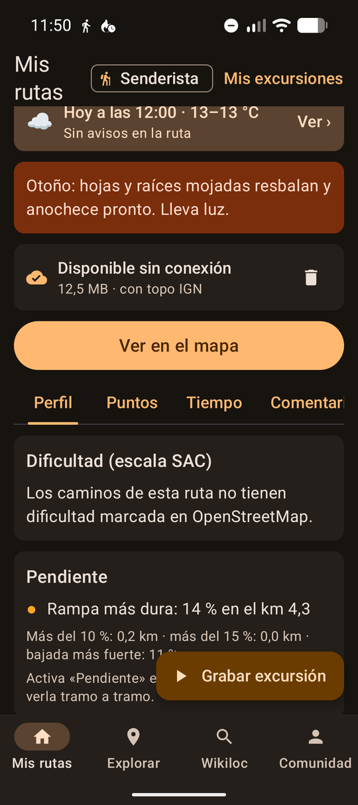
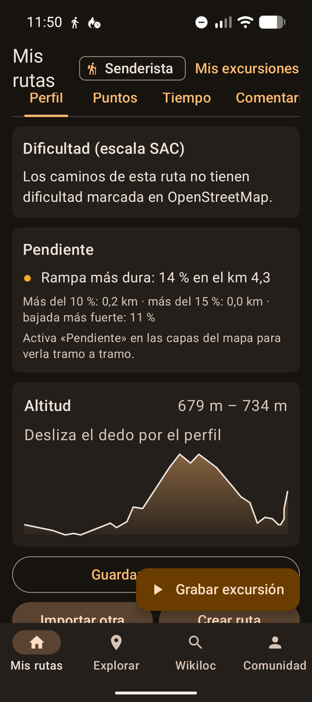
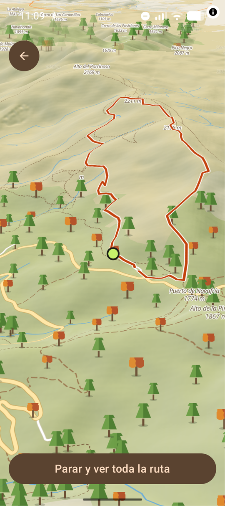
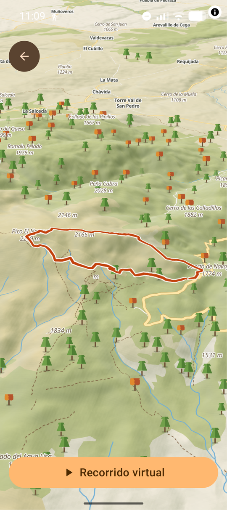

<div align="center">

[Español](README.md) · **English**


# Trazo

**Mountain routes, by bike or on foot, on a map that is a pleasure to look at.**

Import your GPX files from Wikiloc, find the OpenStreetMap routes around you, create your own
and follow them with off-route alerts, an elevation profile and a 3D view. No accounts and no ads.

[](https://github.com/cfernande1408/trazo/actions/workflows/ci.yml)


[Screenshots](#screenshots) · [What it does](#what-it-does) · [All features (Spanish)](FEATURES.md) · [Install](#install) · [How it is built](#how-it-is-built) · [Data and services](#data-and-services) · [Roadmap](#roadmap)

</div>

> [!NOTE]
> Trazo is a personal project in development. It may have bugs: if you find one, please open an *issue*.

## Screenshots

| Route summary | Gradient and profile | Virtual 3D flyover | 3D view |
| :---: | :---: | :---: | :---: |
|  |  |  |  |

## What it does

**Biker or hiker.** You choose the first time you open the app and everything adapts: the theme,
the routes you see, how far off the route the alert goes off, the stats and the estimated time
(MIDE method for hiking). You can change it whenever you like.

**Made for you.** Tell your profile how often you go out and Trazo sets each route's time to your
pace, refining it with your completed routes. Each route tells you whether it is easy, right for
you, hard or very hard for you.

**In Spanish and English.** The app follows your phone's language and you can change it in Info;
voice navigation speaks the language you choose.

**Discover Trazo.** On Home, one card per feature with its icon, what it does and a button to try
it. Tick the circle once you know it or swipe the card away; you can bring them back from Info.

**Saved.** One tab with everything on your phone, like a Spotify library: your routes, your
completed routes and your offline maps, each with its own chip. A completed route can be
**analysed** (your time against MIDE, difficulty, surface, map with the gradient, your points and
3D view) or **repeated** (plan it again, with weather and navigation).

**Search.** Type *Bola del Mundo* or *PR-M 13*: it takes you there and shows the routes around it,
or straight to the routes with that name. With a **List** button to see every route in the area,
from nearest to furthest.

**Explore.** A map of your area with an icon for each MTB, cycling or hiking route in
OpenStreetMap. Tap it and the route is drawn, with distance, climbing and profile. You can
filter loops or one-way routes, like on Wikiloc.

**Your Wikiloc GPX files.** Download them in the built-in browser or open them with *Share → Trazo*.
A summary with a topo map, a draggable profile, the author's waypoints and a link to the comments on Wikiloc.

**Create routes.** Tap points on the map and the route snaps to tracks or trails. Move or delete
points, insert one in between by tapping the route, undo, loop or out and back. They stay on your
phone and work offline.

**Weather along the route.** Pick a day and start time and see the weather on each stretch at the
time you will pass it and at its real altitude. It warns of storms, ice, gusts or rain and tells you
at which km they start. In *Detail*, one line every 15 minutes with where you will be, the
feels-like temperature, wind and rain, and what to wear in layers.

**Layers like Google Maps.** A button on the right to switch to **IGN topo** (Spain's official
1:25,000 map with contour lines) or **Satellite** (PNOA orthophoto), also in 3D, and to turn the
relief, trees and waymarked routes on or off.

**Offline.** Download the map for a route's area or for what you see in *Explore*, with relief and
IGN topo, and navigate with no signal deep in the mountains.

**Gradient and difficulty.** The route coloured by gradient, the steepest ramp and the technical
difficulty from OpenStreetMap (MTB scale S0–S6 or SAC T1–T6) of the paths it uses, and how many km
are paved, track, trail or steps.

**Navigate.** Your position on the route, a vibration when you go off it, the next climb, starting
from the beginning or from the car park, and *Directions* with Google Maps.

**Like a dedicated GPS.** What Wikiloc and Komoot don't have:
- **Live climbs**: "Climb 2 of 4 · 9%", what is left and the climb profile with your position.
- **Voice prompts** at turns, at the start of each climb, at water points and when you go off route.
- **Daylight left**: how much daylight you have to spare (or are short of) to finish at your real pace, with an alert if it is tight.
- **Water and shelters ahead**: OSM water points and shelters along the route, with their km.
- **Barometric altimeter**: if the phone has a barometer, the climbing comes from air pressure and not from GPS jumps.
- **Reroutes by itself** when you go off: the shortest way back to the route, ahead of you, and then it follows the route.

**Community (coming soon).** Alerts on the map from other users (ice, fallen tree, closed path…)
that expire on their own and can be voted on, and star ratings and comments for each route.
The code is done; the server still needs to be set up.

**Training.** Bluetooth heart rate, cadence and power sensors (beta), saved in the GPX for Strava.
Six navigation fields of your choice and a virtual partner that tells you how far ahead or behind
you are compared with the last time you did the route.

**Safety.** Back to the start the way you came (offline) or by the shortest way. An SOS button with
your position in UTM and degrees to read out to 112, call or send by text. And fall detection: if you
fall and don't respond within 60 s, it texts your contact.

**3D view.** Relief with automatic exaggeration, buildings in volume, forests of standing trees and
a virtual flyover along the route.

**Record outings.** It keeps recording with the screen off. Average and top speed, moving time, the
track coloured by speed and GPX export. You can mark points along the way (water, viewpoint,
hazard…) with a note and a photo, and they stay in the GPX.

**By season.** The map, the trees and the theme accent change through the year: flowers in spring,
orange leaves in autumn, snowy pines in winter. Even the app icon changes. Plus a seasonal tip before
you go, like the one about wet leaves and early sunsets in autumn.

**Sun mode.** A high-contrast light theme to read the screen in full sun, and a dark one for the rest.

The full list, one line per feature, is in **[FEATURES.md](FEATURES.md)** (in Spanish).

## Install

There are three versions, which install as separate apps and can live side by side, each with its own data:

| Version | Where from | When it changes | Name on the phone |
| --- | --- | --- | --- |
| Stable | [Releases](https://github.com/cfernande1408/trazo/releases/latest) | when a version is published (`v0.4.0`…) | Trazo |
| Beta | [Releases → beta](https://github.com/cfernande1408/trazo/releases/tag/beta) | on every change to `main` | Trazo beta |
| Debug | building it yourself | when you install it over USB | Trazo debug |

The stable one is for going out; the beta, for trying what is new without risking your routes.
Download the APK and open it on your phone (you need to allow installing apps from that source).
Google Play Protect may warn about an unknown developer: tap *Install anyway*.

The **Info** tab in the app shows which version you have. The stable one is named after its tag
(`0.4.0`); beta and debug add a number that goes up with each change (`0.4.0.58-beta`,
`0.4.0.12-debug`), plus the commit they come from.

It runs on Android 8.0 (API 26) or later and does not need Google Play Services.

To build it, publish versions or set up the community, see [docs/DESARROLLO.md](docs/DESARROLLO.md) (in Spanish).

### Trazo web

To review routes on your computer before you go: **[cfernande1408.github.io/trazo](https://cfernande1408.github.io/trazo/)**.
Explore the waymarked OpenStreetMap routes by moving the map or with the search box, as in the app,
or open or drop your GPX files, and see the route on Trazo's topo map, the IGN topo or the
orthophoto, the profile coloured by gradient (hovering marks the point on the map), the difficulty
and surface (paved, track or trail), the 3D view with a virtual flyover, the weather along the way
at the start time you choose with what to wear, the steepest ramps, the estimated time by bike or
on foot and the author's waypoints. From there you can download the GPX to open it on your phone.
It is not for navigating: to follow the route out there, use the app.
It is in Spanish and English: it follows the browser's language and you can switch with ES / EN.
As a trial it uses the Catppuccin colour theme (Latte by day, Mocha at night); the palette
button at the top goes back to Trazo's colours.

Files never leave your browser; Open-Meteo is only asked for altitudes (if the GPX has none) and
for the forecast at a few points of the route.

## How it is built

| | |
| --- | --- |
| **UI** | Kotlin, Jetpack Compose and Material Design 3 |
| **Map** | MapLibre Native with its own topo style (hillshading and drawn trees) |
| **3D** | MapLibre GL JS in a WebView, with relief, buildings and trees |
| **Location** | Android's `LocationManager`, without Google's provider |
| **Core** | Pure Kotlin module, no dependencies, with tests |
| **Languages** | Spanish and English, with each text next to its code (`L("es", "en")`) |

```
core/gpx/      Pure Kotlin: everything that can be tested without a phone
  gpx/           GPX parser and writer, stats, profile, GeoJSON, seasons
  gpx/i18n/      language and texts in Spanish and English
  gpx/nav/       navigation: matching to the route, off-route, climbs
  gpx/osm/       Overpass, Waymarked Trails, Nominatim, joining ways, altitude
  gpx/ride/      recording and stats of outings
  gpx/plan/      BRouter (creating routes)
  gpx/weather/   forecast along the route
  gpx/layers/    map types and layers
  gpx/offline/   area and size of offline maps
  gpx/safety/    UTM, SOS message and fall detection
  gpx/sensors/   reading Bluetooth sensors (heart rate, cadence, power)
  gpx/community/ ratings and alerts: rules, URLs and Supabase JSON
supabase/      community database schema
web/           Trazo web (TypeScript, Vite and MapLibre GL JS), to review routes on a computer
app/           Android
  importer/      Home (route summary) and Saved
  explore/       Explore, search and Wikiloc browser
  map/           topo map, navigation and 3D view
  plan/          create route and route library
  ride/          recording outings and their history
  ui/            theme, biker/hiker mode, language, charts
```

## Data and services

All of them are open and free services. Trazo collects no data: your routes, outings and settings
stay on your phone. When the community is live, only what you post there will leave it.

| What for | Service | Data |
| --- | --- | --- |
| Base map | [OpenFreeMap](https://openfreemap.org) | © OpenStreetMap contributors |
| Relief and 3D | [Terrain Tiles on AWS](https://registry.opendata.aws/terrain-tiles/) | Mapzen and other sources |
| Routes in the area | [Waymarked Trails](https://waymarkedtrails.org) and [Overpass API](https://overpass-api.de) | © OpenStreetMap contributors |
| Topo and satellite | [IGN · CNIG](https://www.ign.es/wmts) (MTN and PNOA, Spain only) | © Instituto Geográfico Nacional, CC BY 4.0 |
| Waymarked routes | [Waymarked Trails](https://waymarkedtrails.org) (tiles) | © OpenStreetMap contributors |
| Place search | [Nominatim](https://nominatim.org) | © OpenStreetMap contributors |
| Creating routes | [BRouter](https://brouter.de) | © OpenStreetMap contributors |
| Altitude | [Open-Meteo](https://open-meteo.com) | Copernicus DEM |
| Water and shelters | [Overpass API](https://overpass-api.de) | © OpenStreetMap contributors |
| Community | [Supabase](https://supabase.com) (own project) | What users post |
| Weather forecast | [Open-Meteo](https://open-meteo.com) | ECMWF, DWD, Météo-France and other models |
| 3D view | [MapLibre GL JS](https://maplibre.org) | — |
| Web theme (trial) | [Catppuccin](https://catppuccin.com) | Palette under the MIT licence |

OpenStreetMap data is licensed under the [ODbL](https://www.openstreetmap.org/copyright).

Wikiloc is a trademark of its owners and Trazo is not affiliated with it. The app only opens its
website and reads the GPX files you download: it does not copy routes or comments automatically.

## Roadmap

- [x] Move, delete and insert points in *Create route*, and out and back
- [x] Voice prompts at turns
- [x] Live climbs, daylight left and water and shelters ahead
- [x] Back to the start the way you came or by the shortest way
- [x] My position for 112 (UTM and degrees, by text)
- [x] Fall detection with an alert to a contact
- [x] Bluetooth sensors: heart rate, cadence and power
- [x] Virtual partner against your last outing
- [x] Customisable navigation data screen
- [x] Offline maps for a route's area
- [x] OSM difficulty (`mtb:scale`, `sac_scale`) and gradient by stretch
- [x] Download any area from *Explore*
- [x] Climbing from the phone's barometer
- [x] Mark points with a note and photo while recording
- [x] Route surface: paved, track, trail and steps
- [x] Reroute when you go off the route
- [x] Filter loops or one-way routes in *Explore*
- [x] Weather every 15 minutes and what to wear
- [x] Calories burned and a home screen with your week
- [x] Discover Trazo cards on Home
- [x] Analyse or repeat completed routes
- [x] Trazo web in Spanish and English
- [x] The app in Spanish and English, with voice in the chosen language
- [x] Trial Catppuccin theme in Trazo web
- [x] Times at your pace and difficulty for you based on your fitness
- [x] Gradient button in view on the route map
- [ ] Community: user ratings and alerts (ice, fallen tree…), once the server is live
- [ ] Photos in alerts and ratings
