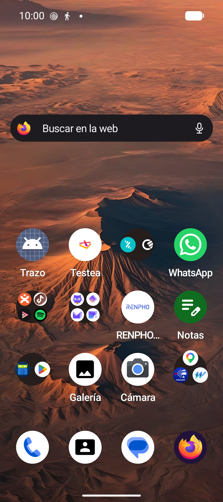

<div align="center">


# Trazo

**Rutas de montaña, en bici o a pie, con un mapa que da gusto mirar.**

Importa tus GPX de Wikiloc, encuentra las rutas de OpenStreetMap de tu zona, crea las tuyas
y síguelas con avisos de desvío, perfil de desnivel y vista 3D. Sin cuentas, sin anuncios
y sin claves de API.


[Qué hace](#qué-hace) · [Capturas](#capturas) · [Instalar](#instalar) · [Cómo está hecho](#cómo-está-hecho) · [Datos y servicios](#datos-y-servicios) · [Hoja de ruta](#hoja-de-ruta)

</div>

> [!NOTE]
> Trazo es un proyecto personal en desarrollo (v0.1). Puede tener fallos: si encuentras uno, abre un *issue*.

## Capturas

| Explorar | Buscar | Ruta | Navegar |
| :---: | :---: | :---: | :---: |
|  |  |  |  |
| **Vista 3D** | **Crear ruta** | **Grabar** | **Senderismo** |
|  |  |  |  |

## Qué hace

🚵 **Biker o senderista.** Lo eliges al abrir la app por primera vez y se adapta todo: el tema,
las rutas que ves, a cuántos metros salta el aviso de desvío, las estadísticas y el tiempo
estimado (método MIDE en senderismo). Lo cambias cuando quieras.

🔎 **Buscador.** Escribe *Bola del Mundo* o *PR-M 13*: te lleva al sitio y te enseña las rutas
de alrededor, o directamente las que se llaman así. Con un botón de **Lista** para ver todas
las de la zona de la más cercana a la más lejana.

🗺️ **Explorar.** Un mapa de tu zona con un icono por cada ruta MTB, ciclista o sendero de
OpenStreetMap. Tócalo y se dibuja el recorrido, con distancia, desnivel y perfil.

📥 **Tus GPX de Wikiloc.** Descárgalos en el navegador integrado o ábrelos con *Compartir → Trazo*.
Resumen con mapa topo, perfil arrastrable, puntos del autor y enlace a los comentarios en Wikiloc.

✏️ **Crear rutas.** Toca puntos en el mapa y la ruta se ajusta sola a pistas o senderos.
Deshacer, cerrar en circular, guardar. Se quedan en el móvil y funcionan sin conexión.

🧭 **Navegar.** Tu posición sobre la ruta, vibración al salirte, la próxima subida, empezar
desde el inicio o desde el parking y *Cómo llegar* con Google Maps.

🏔️ **Vista 3D.** Relieve con exageración automática, casas en volumen, bosques de árboles de pie
y un recorrido virtual que vuela la ruta.

⏺️ **Grabar salidas.** Sigue grabando con la pantalla apagada. Velocidad media y máxima, tiempo en
movimiento, el recorrido coloreado por velocidad y exportación a GPX.

🍂 **Según la estación.** El mapa, los árboles y el acento del tema cambian con el año: flores en
primavera, hojas naranjas en otoño, pinos nevados en invierno. Y un consejo de temporada antes de salir.

🌞 **Modo sol.** Tema claro de alto contraste para leer la pantalla a pleno sol, y oscuro para el resto.

## Instalar

Todavía no hay APK publicada. Para compilarla necesitas JDK 17+ y el SDK de Android (compileSdk 35):

```bash
git clone https://github.com/cfernande1408/trazo.git
cd trazo
echo "sdk.dir=$HOME/Android/Sdk" > local.properties   # si no lo crea Android Studio
./gradlew :app:installDebug                            # con el móvil conectado por USB
```

Funciona en Android 8.0 (API 26) o superior. No necesita Google Play Services.

## Cómo está hecho

| | |
| --- | --- |
| **Interfaz** | Kotlin, Jetpack Compose y Material Design 3 |
| **Mapa** | MapLibre Native con un estilo topo propio (sombreado de relieve y árboles dibujados) |
| **3D** | MapLibre GL JS en una WebView, con relieve, edificios y árboles |
| **Ubicación** | `LocationManager` de Android, sin el proveedor de Google |
| **Núcleo** | Módulo de Kotlin puro, sin dependencias, con tests |

```
core/gpx/      Kotlin puro: todo lo que se puede probar sin móvil
  gpx/           parser y escritor GPX, estadísticas, perfil, GeoJSON, estaciones
  gpx/nav/       navegación: emparejar con la ruta, desvíos, subidas
  gpx/osm/       Overpass, Waymarked Trails, Nominatim, unión de tramos, altitud
  gpx/ride/      grabación y estadísticas de salidas
  gpx/plan/      BRouter (crear rutas)
app/           Android
  importer/      Mis rutas
  explore/       Explorar, buscador y navegador de Wikiloc
  map/           mapa topo, navegación y vista 3D
  plan/          crear ruta y biblioteca de rutas
  ride/          grabar salidas y su historial
  ui/            tema, modo biker/senderista, gráficos
```

```bash
./gradlew :core:gpx:test        # tests del núcleo
./gradlew :app:assembleDebug    # APK de debug
./scripts/screenshot.sh ruta    # captura del móvil para el README
```

## Datos y servicios

Todo son servicios abiertos y gratuitos. Trazo no tiene servidor propio ni recoge datos:
tus rutas, salidas y ajustes se quedan en el móvil.

| Para qué | Servicio | Datos |
| --- | --- | --- |
| Mapa base | [OpenFreeMap](https://openfreemap.org) | © colaboradores de OpenStreetMap |
| Relieve y 3D | [Terrain Tiles en AWS](https://registry.opendata.aws/terrain-tiles/) | Mapzen y otras fuentes |
| Rutas de la zona | [Waymarked Trails](https://waymarkedtrails.org) y [Overpass API](https://overpass-api.de) | © colaboradores de OpenStreetMap |
| Buscar lugares | [Nominatim](https://nominatim.org) | © colaboradores de OpenStreetMap |
| Crear rutas | [BRouter](https://brouter.de) | © colaboradores de OpenStreetMap |
| Altitud | [Open-Meteo](https://open-meteo.com) | Copernicus DEM |
| Vista 3D | [MapLibre GL JS](https://maplibre.org) | — |

Los datos de OpenStreetMap están bajo licencia [ODbL](https://www.openstreetmap.org/copyright).

Wikiloc es una marca de sus propietarios y Trazo no está afiliada a ella. La app solo abre su
web y lee los GPX que tú descargas: no copia rutas ni comentarios de forma automática.

## Hoja de ruta

- [ ] Arrastrar los puntos de una ruta creada
- [ ] Avisos por voz en los cruces
- [ ] Mapas sin conexión por zonas
- [ ] Dificultad de OSM (`mtb:scale`, `sac_scale`) en las rutas
- [ ] Comunidad: valoraciones y avisos de los usuarios (hielo, árbol caído…)
