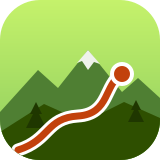
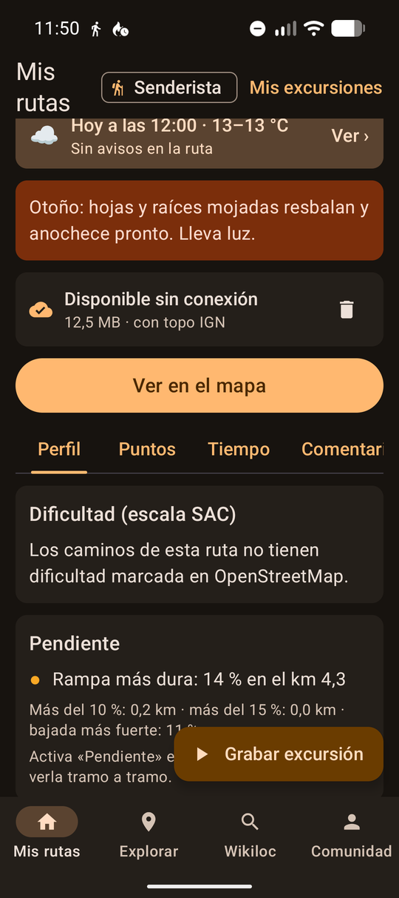
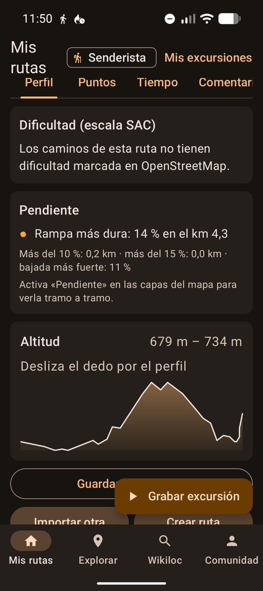
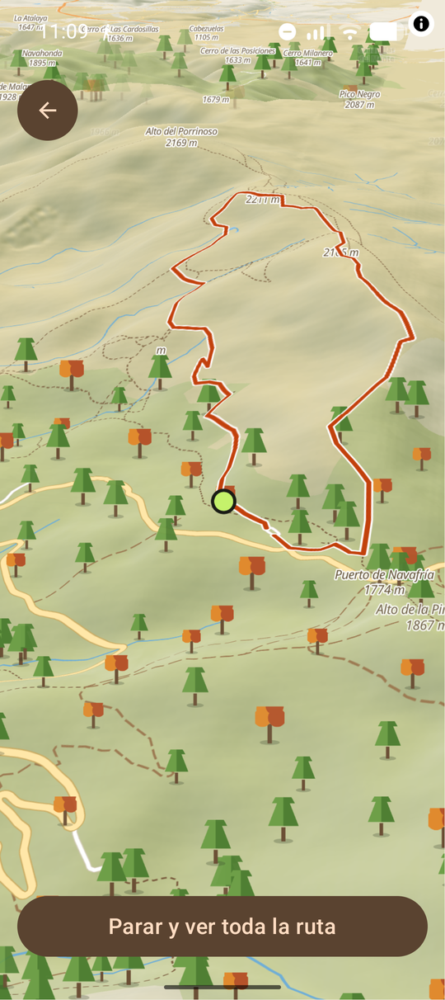
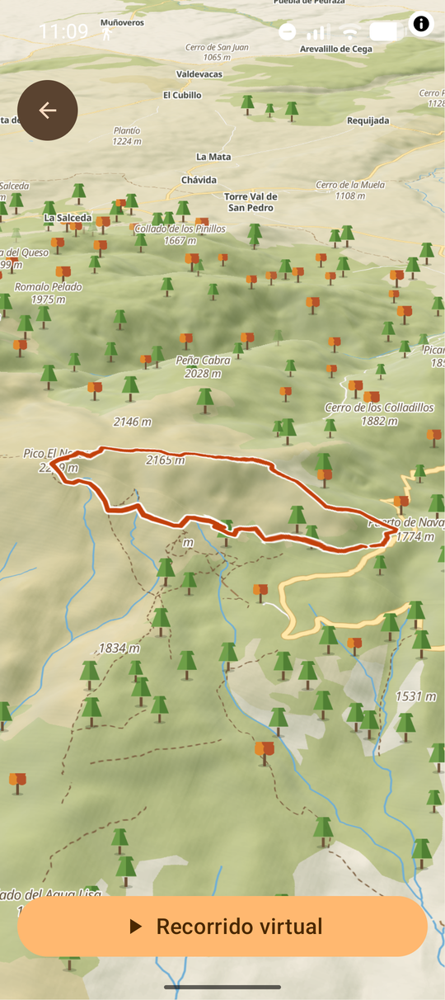

<div align="center">



# Trazo

**Rutas de montaña, en bici o a pie, con un mapa que da gusto mirar.**

Importa tus GPX de Wikiloc, encuentra las rutas de OpenStreetMap de tu zona, crea las tuyas
y síguelas con avisos de desvío, perfil de desnivel y vista 3D. Sin cuentas y sin anuncios.

[](https://github.com/cfernande1408/trazo/actions/workflows/ci.yml)


[Capturas](#capturas) · [Qué hace](#qué-hace) · [Todas las funciones](FEATURES.md) · [Instalar](#instalar) · [Cómo está hecho](#cómo-está-hecho) · [Datos y servicios](#datos-y-servicios) · [Hoja de ruta](#hoja-de-ruta)

</div>

> [!NOTE]
> Trazo es un proyecto personal en desarrollo. Puede tener fallos: si encuentras uno, abre un *issue*.

## Capturas

| Resumen de la ruta | Pendiente y perfil | Recorrido virtual en 3D | Vista 3D |
| :---: | :---: | :---: | :---: |
|  |  |  |  |

## Qué hace

**Biker o senderista.** Lo eliges al abrir la app por primera vez y se adapta todo: el tema,
las rutas que ves, a cuántos metros salta el aviso de desvío, las estadísticas y el tiempo
estimado (método MIDE en senderismo). Lo cambias cuando quieras.

**Buscador.** Escribe *Bola del Mundo* o *PR-M 13*: te lleva al sitio y te enseña las rutas
de alrededor, o directamente las que se llaman así. Con un botón de **Lista** para ver todas
las de la zona de la más cercana a la más lejana.

**Explorar.** Un mapa de tu zona con un icono por cada ruta MTB, ciclista o sendero de
OpenStreetMap. Tócalo y se dibuja el recorrido, con distancia, desnivel y perfil.

**Tus GPX de Wikiloc.** Descárgalos en el navegador integrado o ábrelos con *Compartir → Trazo*.
Resumen con mapa topo, perfil arrastrable, puntos del autor y enlace a los comentarios en Wikiloc.

**Crear rutas.** Toca puntos en el mapa y la ruta se ajusta sola a pistas o senderos.
Mueve o borra puntos, inserta uno en medio tocando la ruta, deshacer, circular o ida y vuelta. Se quedan en el móvil y funcionan sin conexión.

**El tiempo en la ruta.** Elige día y hora de salida y mira qué tiempo hará en cada tramo
a la hora en que pasarás por él y a su altitud real. Avisa de tormenta, hielo, rachas o lluvia
y dice en qué km empieza.

**Capas como en Google Maps.** Botón a la derecha para cambiar a **Topo IGN** (el mapa
oficial 1:25.000 con curvas de nivel) o **Satélite** (ortofoto PNOA), también en 3D, y para
encender o apagar el relieve, los árboles y las rutas señalizadas.

**Sin conexión.** Descarga el mapa de la zona de una ruta o de lo que ves en *Explorar*, con
relieve y topo IGN, y navega sin cobertura en plena sierra.

**Pendiente y dificultad.** La ruta coloreada por pendiente, la rampa más dura y la
dificultad técnica de OpenStreetMap (escala MTB S0–S6 o SAC T1–T6) de los caminos por los
que pasa, y cuántos km van por asfalto, pista, sendero o escaleras.

**Navegar.** Tu posición sobre la ruta, vibración al salirte, la próxima subida, empezar
desde el inicio o desde el parking y *Cómo llegar* con Google Maps.

**Como un GPS profesional.** Lo que Wikiloc y Komoot no tienen:
- **Subidas en directo**: «Subida 2 de 4 · 9 %», lo que queda y el perfil de la subida con tu posición.
- **Avisos por voz** en los giros, al empezar cada subida, al pasar por una fuente y si te sales.
- **Luz restante**: cuánta luz te sobra o te falta para terminar a tu ritmo real, con aviso si vas justo.
- **Agua y refugios por delante**: fuentes y refugios de OSM a lo largo de la ruta, con su km.
- **Altímetro barométrico**: si el móvil tiene barómetro, el desnivel sale de la presión y no de los saltos del GPS.

**Comunidad (en preparación).** Avisos en el mapa de otros usuarios (hielo, árbol caído, camino
cortado…) que caducan solos y se votan, y valoraciones con estrellas y comentarios de cada ruta.
El código está hecho; falta poner en marcha el servidor.

**Entrenamiento.** Sensores Bluetooth de pulso, cadencia y potencia (en pruebas), grabados en el GPX
para Strava. Seis cifras de navegación a tu gusto y un compañero virtual que te dice cuánto vas
por delante o por detrás de la última vez que hiciste la ruta.

**Seguridad.** Volver al inicio por donde has venido (sin conexión) o por el camino más
corto. Botón SOS con tu posición en UTM y grados para dictarla al 112, llamar o mandarla por
SMS. Y detección de caídas: si te caes y no respondes en 60 s, avisa a tu contacto por SMS.

**Vista 3D.** Relieve con exageración automática, casas en volumen, bosques de árboles de pie
y un recorrido virtual que vuela la ruta.

**Grabar salidas.** Sigue grabando con la pantalla apagada. Velocidad media y máxima, tiempo en
movimiento, el recorrido coloreado por velocidad y exportación a GPX. Puedes marcar puntos por el
camino (fuente, mirador, peligro…) con una nota y una foto, y quedan en el GPX.

**Según la estación.** El mapa, los árboles y el acento del tema cambian con el año: flores en
primavera, hojas naranjas en otoño, pinos nevados en invierno. Hasta el icono de la app cambia. Y un consejo de temporada antes de
salir, como el de las hojas mojadas y el anochecer temprano en otoño.

**Modo sol.** Tema claro de alto contraste para leer la pantalla a pleno sol, y oscuro para el resto.

La lista completa, una línea por función, está en **[FEATURES.md](FEATURES.md)**.

## Instalar

Hay tres versiones, que se instalan como apps distintas y pueden convivir, cada una con sus datos:

| Versión | De dónde | Cuándo cambia | Nombre en el móvil |
| --- | --- | --- | --- |
| Estable | [Releases](https://github.com/cfernande1408/trazo/releases/latest) | al publicar una versión (`v0.3.0`…) | Trazo |
| Beta | [Releases → beta](https://github.com/cfernande1408/trazo/releases/tag/beta) | en cada cambio en `main` | Trazo beta |
| Debug | compilándola tú | cuando la instalas con el cable | Trazo debug |

La estable es la de salir al monte; la beta, para probar lo nuevo sin arriesgar tus rutas. Descarga
el APK y ábrelo en el móvil (hay que permitir instalar apps de esa fuente).

La pestaña **Info** de la app dice qué versión llevas. La estable se llama como su etiqueta
(`0.3.0`); la beta y la debug añaden un número que sube con cada cambio (`0.3.0.58-beta`,
`0.3.0.12-debug`), además del commit del que salen.

Funciona en Android 8.0 (API 26) o superior y no necesita Google Play Services.

Para compilarla, publicar versiones o activar la comunidad, mira [docs/DESARROLLO.md](docs/DESARROLLO.md).

## Cómo está hecho

| | |
| --- | --- |
| **Interfaz** | Kotlin, Jetpack Compose y Material Design 3 |
| **Mapa** | MapLibre Native con un estilo topo propio (sombreado de relieve y árboles dibujados) |
| **3D** | MapLibre GL JS en una WebView, con relieve, edificios y árboles |
| **Ubicación** | `LocationManager` de Android, sin el proveedor de Google |
| **Núcleo** | Módulo de Kotlin puro, sin dependencias, con tests |

```
core/gpx/      Kotlin puro: todo lo que se puede probar sin móvil
  gpx/           parser y escritor GPX, estadísticas, perfil, GeoJSON, estaciones
  gpx/nav/       navegación: emparejar con la ruta, desvíos, subidas
  gpx/osm/       Overpass, Waymarked Trails, Nominatim, unión de tramos, altitud
  gpx/ride/      grabación y estadísticas de salidas
  gpx/plan/      BRouter (crear rutas)
  gpx/weather/   previsión a lo largo de la ruta
  gpx/layers/    tipos de mapa y capas
  gpx/offline/   zona y tamaño de los mapas sin conexión
  gpx/safety/    UTM, mensaje de SOS y detección de caídas
  gpx/sensors/   lectura de sensores Bluetooth (pulso, cadencia, potencia)
  gpx/community/ valoraciones y avisos: reglas, URLs y JSON de Supabase
supabase/      esquema de la base de la comunidad
app/           Android
  importer/      Mis rutas
  explore/       Explorar, buscador y navegador de Wikiloc
  map/           mapa topo, navegación y vista 3D
  plan/          crear ruta y biblioteca de rutas
  ride/          grabar salidas y su historial
  ui/            tema, modo biker/senderista, gráficos
```

## Datos y servicios

Todo son servicios abiertos y gratuitos. Trazo no recoge datos: tus rutas, salidas y ajustes se
quedan en el móvil. Cuando la comunidad esté activa, lo único que saldrá será lo que publiques en ella.

| Para qué | Servicio | Datos |
| --- | --- | --- |
| Mapa base | [OpenFreeMap](https://openfreemap.org) | © colaboradores de OpenStreetMap |
| Relieve y 3D | [Terrain Tiles en AWS](https://registry.opendata.aws/terrain-tiles/) | Mapzen y otras fuentes |
| Rutas de la zona | [Waymarked Trails](https://waymarkedtrails.org) y [Overpass API](https://overpass-api.de) | © colaboradores de OpenStreetMap |
| Topo y satélite | [IGN · CNIG](https://www.ign.es/wmts) (MTN y PNOA, solo España) | © Instituto Geográfico Nacional, CC BY 4.0 |
| Rutas señalizadas | [Waymarked Trails](https://waymarkedtrails.org) (teselas) | © colaboradores de OpenStreetMap |
| Buscar lugares | [Nominatim](https://nominatim.org) | © colaboradores de OpenStreetMap |
| Crear rutas | [BRouter](https://brouter.de) | © colaboradores de OpenStreetMap |
| Altitud | [Open-Meteo](https://open-meteo.com) | Copernicus DEM |
| Fuentes y refugios | [Overpass API](https://overpass-api.de) | © colaboradores de OpenStreetMap |
| Comunidad | [Supabase](https://supabase.com) (proyecto propio) | Lo que publican los usuarios |
| Previsión del tiempo | [Open-Meteo](https://open-meteo.com) | Modelos de ECMWF, DWD, Météo-France y otros |
| Vista 3D | [MapLibre GL JS](https://maplibre.org) | — |

Los datos de OpenStreetMap están bajo licencia [ODbL](https://www.openstreetmap.org/copyright).

Wikiloc es una marca de sus propietarios y Trazo no está afiliada a ella. La app solo abre su
web y lee los GPX que tú descargas: no copia rutas ni comentarios de forma automática.

## Hoja de ruta

- [x] Mover, borrar e insertar puntos en *Crear ruta*, e ida y vuelta
- [x] Avisos por voz en los giros
- [x] Subidas en directo, luz restante y agua y refugios por delante
- [x] Volver al inicio por donde has venido o por el camino más corto
- [x] Mi posición para el 112 (UTM y grados, por SMS)
- [x] Detección de caídas con aviso a un contacto
- [x] Sensores Bluetooth: pulso, cadencia y potencia
- [x] Compañero virtual contra tu salida anterior
- [x] Pantalla de datos de navegación a tu gusto
- [x] Mapas sin conexión de la zona de una ruta
- [x] Dificultad de OSM (`mtb:scale`, `sac_scale`) y pendiente por tramos
- [x] Descargar cualquier zona desde *Explorar*
- [x] Desnivel con el barómetro del móvil
- [x] Marcar puntos con nota y foto mientras grabas
- [x] Por dónde va la ruta: asfalto, pista, sendero y escaleras
- [ ] Comunidad: valoraciones y avisos de los usuarios (hielo, árbol caído…), a falta de activar el servidor
- [ ] Fotos en los avisos y en las valoraciones
